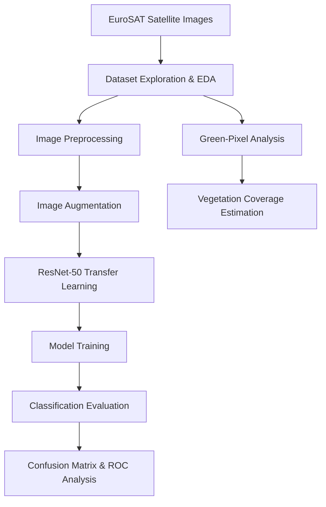

<div align="center">

<picture>
  <source
    media="(prefers-color-scheme: dark)"
    srcset="https://readme-typing-svg.demolab.com?font=Fira+Code&weight=700&size=25&duration=3000&pause=1000&color=36BCF7&center=true&vCenter=true&width=850&lines=Vegetation+Detection+Using+Satellite+Imagery;Deep+Learning+%7C+Computer+Vision;EuroSAT+%7C+ResNet-50+%7C+Transfer+Learning"
  />
  <source
    media="(prefers-color-scheme: light)"
    srcset="https://readme-typing-svg.demolab.com?font=Fira+Code&weight=700&size=25&duration=3000&pause=1000&color=1764A0&center=true&vCenter=true&width=850&lines=Vegetation+Detection+Using+Satellite+Imagery;Deep+Learning+%7C+Computer+Vision;EuroSAT+%7C+ResNet-50+%7C+Transfer+Learning"
  />
  
</picture>

### 🌍 Deep Learning-Based Land Cover Classification & Vegetation Analysis

*Exploring Earth Observation through Artificial Intelligence*

<br/>


<br/>


</div>

---

## 📖 Project Overview

Satellite imagery is an important source of
information for understanding land cover,
vegetation distribution, and environmental
conditions.

This project investigates the application of
**deep learning and image processing techniques**
to satellite imagery using the **EuroSAT dataset**.

The work consists of two related components:

### 🛰️ 1. Land Cover Classification

A ResNet-50-based transfer learning approach
is used to classify satellite imagery into
different land use and land cover categories.

### 🌱 2. Vegetation Analysis

Image-processing techniques are used to estimate
green-pixel percentages and explore vegetation
coverage within satellite images.

> [!IMPORTANT]
> Green-pixel percentage estimation is a
> heuristic method. It does not independently
> establish vegetation health or prove
> vegetation degradation over time.

---

## 🎯 Project Objectives

- Explore satellite imagery and land cover data.
- Conduct exploratory data analysis (EDA).
- Apply image preprocessing and augmentation.
- Develop a ResNet-50 transfer learning workflow.
- Train and evaluate a land cover classifier.
- Analyze classification performance.
- Visualize confusion matrices and ROC curves.
- Explore vegetation coverage estimation.

---

## 🛰️ Dataset — EuroSAT

The project uses the **EuroSAT dataset**,
which is based on Sentinel-2 satellite imagery.

| Property | Details |
|:---|:---|
| Dataset | EuroSAT |
| Satellite | Sentinel-2 |
| Total Images | 27,000 |
| Land Cover Classes | 10 |
| Primary Task | Land Use / Land Cover Classification |
| Model Architecture | ResNet-50 |

### 🗺️ Land Cover Categories

| Class | Description |
|:---|:---|
| 🌾 Annual Crop | Agricultural crop areas |
| 🌲 Forest | Forest-covered regions |
| 🌿 Herbaceous Vegetation | Herbaceous plant coverage |
| 🛣️ Highway | Road and highway infrastructure |
| 🏭 Industrial | Industrial areas |
| 🌱 Pasture | Grazing and pasture land |
| 🌳 Permanent Crop | Long-term agricultural crops |
| 🏘️ Residential | Residential settlements |
| 🌊 River | River and watercourse regions |
| 🏖️ Sea/Lake | Large water bodies |

**Dataset Reference:**
[EuroSAT Dataset Repository](https://github.com/phelber/EuroSAT)

---

## 🔄 Project Workflow

The overall workflow includes data exploration,
image preprocessing, model development,
classification evaluation, and vegetation analysis.



---

## 🧠 Deep Learning Methodology

### ResNet-50 Architecture

The project explores **ResNet-50**, a deep
convolutional neural network architecture
that uses residual connections.

Transfer learning enables the reuse of
previously learned visual representations
for a new image classification task.

<details>
<summary><b>🔍 Click to expand: Model Development</b></summary>

<br/>

### Development Pipeline

**1. Dataset Preparation**

- Organize EuroSAT imagery.
- Prepare image labels and class information.
- Create data loaders.

**2. Image Preprocessing**

- Apply image transformations.
- Prepare images for model input.
- Apply data augmentation where appropriate.

**3. Model Development**

- Initialize the ResNet-50 architecture.
- Adapt the classification workflow.
- Configure training parameters.

**4. Training**

- Train the model using the prepared data.
- Monitor training performance.
- Evaluate classification predictions.

**5. Evaluation**

- Calculate classification metrics.
- Generate confusion matrices.
- Analyze ROC curves.

</details>

---

## 🌿 Vegetation Coverage Analysis

The project also explores image-based
vegetation estimation using green-pixel analysis.

### General Approach

1. Load a satellite image.
2. Analyze pixel color information.
3. Identify pixels satisfying the selected
   green-color criteria.
4. Calculate the percentage of selected pixels.
5. Use the resulting estimate for exploratory
   vegetation coverage analysis.

<details>
<summary><b>🌱 Click to expand: Methodological Limitations</b></summary>

<br/>

Green-pixel estimation has important limitations:

- Visible green color does not always
  correspond directly to vegetation.
- Vegetation appearance can vary with season,
  lighting, and image conditions.
- Non-vegetation surfaces may contain
  green-colored pixels.
- A single image does not establish
  vegetation loss over time.

More advanced approaches could incorporate
vegetation indices, multispectral imagery,
or validated segmentation methods.

</details>

---

## 📊 Model Evaluation

The project contains evaluation procedures
for analyzing classification performance.

### Evaluation Components

| Component | Purpose |
|:---|:---|
| Classification Metrics | Assess prediction performance |
| Confusion Matrix | Examine class-level prediction errors |
| ROC Analysis | Explore classification discrimination |
| Visualization | Interpret model outputs |

> [!NOTE]
> Verified numerical performance results will
> be documented after the evaluation workflow
> has been reviewed and standardized.

### Planned Evaluation Improvements

- Separate training and validation workflows.
- Reserve an independent final test set.
- Document training configuration.
- Report verified experimental metrics.
- Include saved result figures.

---

## 🛠️ Technology Stack

<div align="center">

| Category | Technologies |
|:---|:---|
| Programming Language | Python |
| Deep Learning | PyTorch, Torchvision |
| Model Architecture | ResNet-50 |
| Data Processing | NumPy |
| Visualization | Matplotlib |
| Machine Learning Utilities | Scikit-learn |
| Development Environment | Jupyter Notebook, Google Colab |

</div>

---

## 📂 Repository Structure

The repository currently preserves
the original academic coursework.

```text
Vegetation-Detection-Using-Satellite-Imagery/
│
├── Task 2/
├── Task 3/
├── Task 4/
├── Task 6/
├── Task 7/
│
└── README.md
```

### Planned Standalone Structure

```text
Vegetation-Detection-Using-Satellite-Imagery/
│
├── README.md
├── requirements.txt
├── .gitignore
│
├── notebooks/
│   └── eurosat_eda_and_classification.ipynb
│
├── src/
│   ├── data_preprocessing.py
│   ├── model.py
│   ├── train.py
│   └── evaluate.py
│
├── results/
│   └── figures/
│
├── docs/
│   └── methodology.md
│
└── coursework_archive/
    ├── Task 2/
    ├── Task 3/
    ├── Task 4/
    ├── Task 6/
    └── Task 7/
```

> The standalone structure is a development
> plan. The original coursework directories
> will remain preserved during restructuring.

---

## 📚 Academic Background

This project was developed as part of
**CSE424 at BRAC University**.

The repository preserves the original
coursework, notebooks, and supporting
academic materials.

The ongoing repository enhancement aims
to improve documentation, organization,
and reproducibility without removing
the original academic work.

---

## 👥 Project Contributors

<div align="center">

### 🎓 BRAC University — Group 7

</div>

| Student ID | Group Member |
|:---:|:---|
| 24141153 | Abrar Sami Khan |
| 23241085 | Omor Bin Amjad Chowdhury |
| 21141058 | Mohammad Omor Raihan |
| 24141255 | Showrin Rahman |
| 24341284 | Sowad Rahman |

**Institution:** BRAC University

**Course:** CSE424

**Project Type:** Academic Group Project

---

## 🚀 Development Roadmap

- [x] Preserve original academic coursework.
- [x] Add a professional project README.
- [ ] Organize a standalone project structure.
- [ ] Add a dependency file.
- [ ] Add environment setup instructions.
- [ ] Standardize preprocessing and training.
- [ ] Improve validation and testing separation.
- [ ] Document verified experimental results.
- [ ] Add evaluation figures and sample outputs.
- [ ] Add reusable inference scripts.
- [ ] Improve vegetation analysis methodology.

---

## 📖 References & Resources

- [EuroSAT Dataset](https://github.com/phelber/EuroSAT)
- [PyTorch Documentation](https://pytorch.org/docs/stable/index.html)
- [Torchvision Documentation](https://pytorch.org/vision/stable/index.html)
- [Deep Residual Learning for Image Recognition](https://arxiv.org/abs/1512.03385)
- [Sentinel-2 Mission](https://www.esa.int/Applications/Observing_the_Earth/Copernicus/Sentinel-2)

---

<div align="center">

### 🌍 Exploring Earth Observation through Deep Learning

*Transforming satellite imagery into meaningful insights.*

**Developed by Group 7 | BRAC University**

<br/>


</div>
